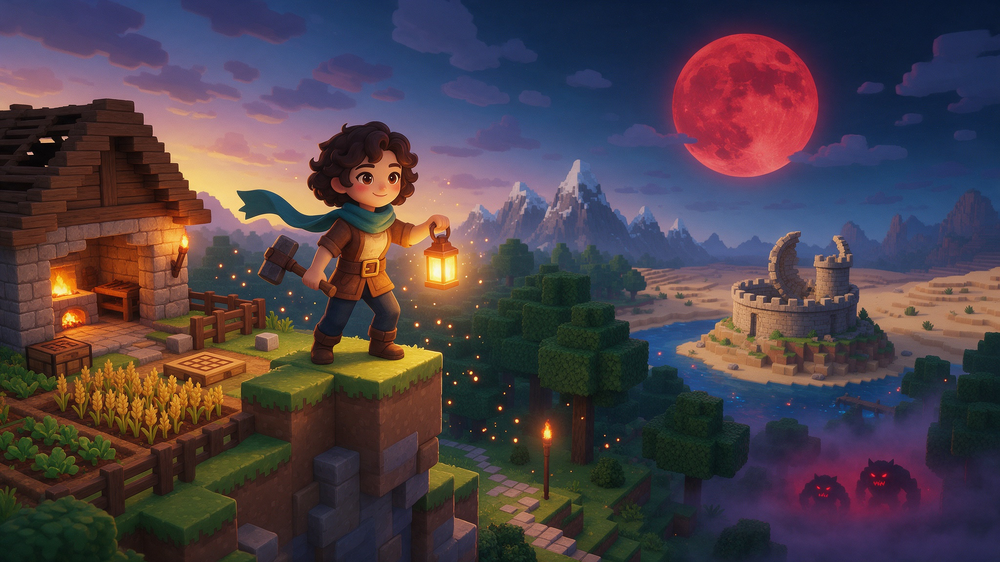

# 3D Voxel Sandbox

Mine, build, farm and survive in a living voxel world that quietly unsettles you.

A complete, optimized voxel survival and building sandbox for [Summer Engine](https://www.summerengine.com) (Godot 4.6, GDScript). Clone it, press Play, and you have a full game to explore, plus a clean, documented foundation to build your own on top of.

## What's inside

**World and exploration**
- Streamed voxel terrain with biomes: meadow, forest, jungle, desert, snow, mountains, oceans and rivers.
- Day/night cycle, dynamic weather and seasons: rain, snow, sandstorms and thunder.
- Discoverable structures with loot: ruined towers, guarded crypts and treasure caches.
- Eerie world systems: mirages, wrong blocks, hauntfields, doppelganger tracks and more.

**Survival and combat**
- Mining and building, crafting, furnace smelting, chests, farming and cooking.
- Tool and armor tiers (wood, stone, iron, diamond) and a hunger and health loop.
- Night sieges of zombies (normal, fast runner, brute), blood moons, cave lurkers and daylight burning.

**Polish**
- Biome fauna (birds, fish, reptiles, farm animals) with positional sounds, animation and VFX.
- 27-slot inventory, crafting UI, hotbar, minimap, advancements, rebindable keys and save/load.
- Optimized with greedy meshing, off-thread chunk builds, shared materials and pooled VFX for a locked ~60 FPS.

## Get started

1. [Download the ZIP](https://github.com/SummerEngine/template-3d-voxel-sandbox/archive/refs/heads/main.zip) or clone the repo:
   `git clone https://github.com/SummerEngine/template-3d-voxel-sandbox.git`
2. Open the folder in [Summer Engine](https://www.summerengine.com/download).
3. Press Play (F5) and choose **Single Player**. Survive, mine, build and explore.

Summer's AI agent can extend it for you. Try asking:

- "Add a fishing rod that catches different fish in each biome."
- "Add a new swamp biome with fog, lily pads and a hostile mob that only spawns there."
- "Add a boss that appears on the third blood moon and drops a unique weapon."

## Controls

| Input | Action |
|---|---|
| **WASD** | Move |
| **Ctrl** | Sprint |
| **Space** | Jump, double-tap to toggle creative fly |
| **Mouse** | Look |
| **1-9 / Scroll** | Select hotbar slot |
| **Left click** | Mine / attack |
| **Right click** | Place block |
| **Q / E** | Switch weapon |
| **G** | Eat |
| **C** | Crafting |
| **M** | Map |
| **J** | Advancements |
| **F5** | Toggle first / third person |
| **F3** | Debug stats |
| **Esc** | Pause / release mouse |

Keys can be rebound in the settings menu.

## Project layout

```
assets/    textures/ models/ materials/ audio/        art and sound (see assets/README.md)
docs/      DESIGN.md design reference, PLAN.md roadmap
scenes/    main_menu.tscn entry scene
scripts/   core/ player/ world/ entities/ ui/         GDScript by responsibility
main.tscn  gameplay scene (loaded from the menu)
```

Tech: Summer Engine / Godot 4.6, Forward+, GDScript, Jolt Physics.

## Documentation

- **[docs/DESIGN.md](docs/DESIGN.md)**: how the template is designed (systems, conventions, extension points).
- **[docs/PLAN.md](docs/PLAN.md)**: the phased build roadmap.

## Contributing (team workflow)

- `main`: stable, reviewed.
- `developer`: integration branch; branch your features off this.
- Open a PR into `developer`; we periodically merge `developer` into `main`.

## License

MIT. See [LICENSE](LICENSE).
